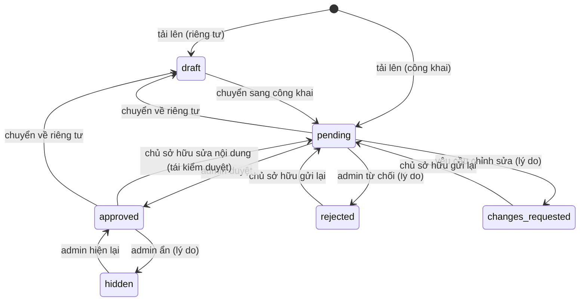
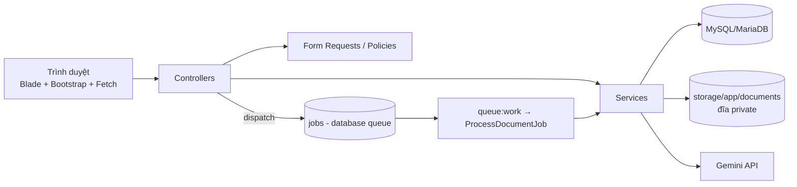

# Phân tích, thiết kế và kiến trúc — Smart Document Hub

## 1. Yêu cầu chức năng (tóm tắt)
- **Khách**: xem trang chủ, danh mục, tìm kiếm, xem thông tin + phần xem trước của tài liệu đã duyệt; đăng ký/đăng nhập.
- **Người dùng**: hồ sơ, tải lên/sửa/xóa tài liệu của mình, theo dõi kiểm duyệt (kèm lý do), gửi lại, tải xuống, yêu thích, đánh giá, bình luận, báo cáo, hỏi đáp AI, lịch sử trò chuyện, thông báo, lịch sử tải.
- **Quản trị viên**: dashboard từ dữ liệu thật, quản lý người dùng/vai trò (khóa/mở khóa), kiểm duyệt (duyệt/từ chối/yêu cầu sửa/ẩn/hiện lại) có lý do + lịch sử, danh mục & thẻ, bình luận & báo cáo, nhật ký kiểm toán, theo dõi tác vụ nền và lỗi AI, cấu hình hạn mức.

## 2. Yêu cầu phi chức năng
Bảo mật (CSRF, validate server, Policy/Gate, throttle, tệp private + kiểm tra chữ ký tệp, khóa API chỉ ở `.env`); toàn vẹn dữ liệu (khóa ngoại, unique, giao dịch); khả năng kiểm chứng (audit log, trích dẫn gắn chunk thật); chạy trên Windows + XAMPP, không cần Node/Docker; giao diện responsive, truy cập bàn phím; có kiểm thử tự động.

## 3. Actor và use case chính
| Actor | Use case |
|---|---|
| Khách | Tìm kiếm / xem tài liệu công khai, đăng ký, đăng nhập |
| Người dùng | Tải lên, quản lý tài liệu, tải xuống, tương tác cộng đồng, hỏi AI |
| Quản trị viên | Kiểm duyệt, quản lý người dùng/danh mục, xử lý báo cáo, giám sát, cấu hình |
| Hệ thống (queue) | Trích xuất văn bản, chia chunk, lập chỉ mục, thông báo kết quả |
| Gemini API | Sinh câu trả lời từ ngữ cảnh đã truy xuất |

## 4. Quy tắc nghiệp vụ quan trọng
1. Tài liệu chỉ xuất hiện công khai khi `visibility = public` **và** `moderation_status = approved`.
2. Tài liệu riêng tư (`draft`) chỉ chủ sở hữu thấy; admin **không** xem tài liệu riêng tư của người khác. Truy cập trái phép trả **404** (không lộ sự tồn tại).
3. Trạng thái **kiểm duyệt** và trạng thái **xử lý tệp** là hai trường riêng. Chỉ khi số chunk lưu thực tế khớp số chunk tạo ra mới đặt `processing_status = completed`.
4. Tìm kiếm nội dung và AI chỉ dùng tài liệu `completed`.
5. Sửa tệp/tiêu đề/mô tả/danh mục của tài liệu đã duyệt ⇒ quay lại `pending` (tái kiểm duyệt).
6. Mỗi lượt tải của người dùng đã đăng nhập tạo 1 bản ghi `downloads` + tăng `download_count`; lượt xem tính 1 lần/phiên, không tính chủ sở hữu.
7. Trùng lặp: chặn nếu cùng người dùng đã có tệp cùng SHA-256, hoặc tệp đó đã công khai.

## 5. Luồng kiểm duyệt (trạng thái tài liệu)

Logic nằm ở `App\Services\Documents\DocumentWorkflow` (bảng chuyển trạng thái `DECISIONS`).

## 6. Kiến trúc

**Thư mục chính và trách nhiệm**
- `app/Http/Controllers` — nhận request, điều phối (không chứa nghiệp vụ nặng). `Admin/` cho khu quản trị.
- `app/Http/Requests` — validate (tải lên: kiểm tra phần mở rộng + magic bytes + dung lượng).
- `app/Policies/DocumentPolicy`, `Gate admin` — phân quyền ở server. `app/Http/Middleware/EnsureRole`, `EnsureUserIsActive`.
- `app/Services/Documents` — `TextExtractor` (PDF/DOCX/TXT), `Chunker`, `DocumentProcessor`, `DocumentWorkflow`, `DocumentStorage`.
- `app/Services/Search` — `SearchService` (tìm từ khóa), `Retriever` (truy xuất chunk cho RAG).
- `app/Services/Ai` — `GeminiService`, `RagService`, `CitationParser`.
- `app/Services/Audit/AuditLogger` — nhật ký kiểm toán.
- `app/Jobs/ProcessDocumentJob`, `app/Notifications/*`, `app/Console/Commands/*` (`daln:create-admin`, `daln:reprocess`).
- `resources/views` — Blade (layout, component dùng lại, trang người dùng, `admin/`). `public/js/chat.js` — giao diện chat Fetch API.
- `database/migrations` + `database/schema_smart_document_hub.sql` — cấu trúc DB; `database/seeders` — vai trò + danh mục.
- `tests/` — Unit + Feature.

## 7. Lựa chọn kiến trúc AI: **B — RAG tự triển khai** (không dùng Gemini File Search)
Lý do: (1) toàn quyền kiểm soát **phân quyền** — mỗi câu hỏi tính lại tập tài liệu được phép (đã duyệt/đúng chủ sở hữu/đã đồng ý) trước khi truy xuất, nên tài liệu bị ẩn/xóa/đổi quyền mất hiệu lực ngay; (2) **xóa và phiên bản** đồng bộ trực tiếp trong MySQL (xử lý lại thay thế chunk cũ), không phải đồng bộ với kho bên ngoài; (3) trích dẫn gắn với **chunk và số trang thực tế** nên kiểm chứng được; (4) không thêm dịch vụ/phụ thuộc mới.

Luồng: câu hỏi → tính tập tài liệu được phép → truy xuất chunk (MySQL FULLTEXT, dự phòng LIKE) → dựng ngữ cảnh có đánh số `[n]` trong khối ngăn cách bởi nonce ngẫu nhiên → Gemini (system instruction tách riêng) → **xác minh** trích dẫn (loại số nguồn không tồn tại; chỉ lưu nguồn có thật) → lưu `chat_messages` + `message_sources`.
- Không có chunk phù hợp ⇒ **không gọi Gemini**, trả lời "không đủ thông tin".
- Chống prompt injection: nội dung tài liệu chỉ nằm trong khối dữ liệu có nonce; system instruction nêu rõ đó không phải chỉ thị.
- Tài liệu riêng tư của chính người dùng chỉ được gửi tới Gemini khi họ **đồng ý** (Hồ sơ cá nhân / trang chat).

**Giới hạn thành thật**: truy xuất hiện là **từ khóa** (FULLTEXT), **chưa phải semantic/embedding**. Bảng `document_embeddings` chưa được tạo vì XAMPP không có tìm kiếm vector hiệu quả. Có thể mở rộng bằng cách thêm bảng embeddings và thay `Retriever::search()`.

## 8. Danh sách route
| Method | URI | Controller | Tên route |
|---|---|---|---|
| GET | `/` | HomeController | `home` |
| GET | `/tai-lieu` | LibraryController@index | `library.index` |
| GET | `/tim-kiem` | SearchController@index | `search` |
| GET | `/tim-kiem/goi-y` | SearchController@suggest | `search.suggest` |
| GET | `/tai-lieu/{document}` | LibraryController@show | `library.show` |
| GET | `/dang-ky` | AuthController@showRegister | `register` |
| POST | `/dang-ky` | AuthController@register | `` |
| GET | `/dang-nhap` | AuthController@showLogin | `login` |
| POST | `/dang-nhap` | AuthController@login | `` |
| GET | `/quen-mat-khau` | PasswordResetController@showForgot | `password.request` |
| POST | `/quen-mat-khau` | PasswordResetController@sendLink | `password.email` |
| GET | `/dat-lai-mat-khau/{token}` | PasswordResetController@showReset | `password.reset` |
| POST | `/dat-lai-mat-khau` | PasswordResetController@reset | `password.update` |
| POST | `/dang-xuat` | AuthController@logout | `logout` |
| GET | `/tai-lieu/{document}/tai-xuong` | LibraryController@download | `library.download` |
| GET | `/tai-lieu/{document}/mo-tep` | LibraryController@file | `library.file` |
| GET | `/tai-len` | DocumentController@create | `documents.create` |
| POST | `/tai-len` | DocumentController@store | `documents.store` |
| GET | `/tai-lieu-cua-toi` | DocumentController@mine | `documents.mine` |
| GET | `/tai-lieu/{document}/sua` | DocumentController@edit | `documents.edit` |
| PUT | `/tai-lieu/{document}` | DocumentController@update | `documents.update` |
| DELETE | `/tai-lieu/{document}` | DocumentController@destroy | `documents.destroy` |
| POST | `/tai-lieu/{document}/gui-lai` | DocumentController@resubmit | `documents.resubmit` |
| POST | `/tai-lieu/{document}/xu-ly-lai` | DocumentController@reprocess | `documents.reprocess` |
| GET | `/yeu-thich` | BookmarkController@index | `bookmarks.index` |
| POST | `/tai-lieu/{document}/yeu-thich` | BookmarkController@toggle | `bookmarks.toggle` |
| POST | `/tai-lieu/{document}/danh-gia` | RatingController@store | `ratings.store` |
| POST | `/tai-lieu/{document}/binh-luan` | CommentController@store | `comments.store` |
| DELETE | `/binh-luan/{comment}` | CommentController@destroy | `comments.destroy` |
| POST | `/bao-cao` | ReportController@store | `reports.store` |
| GET | `/lich-su-tai-xuong` | DownloadHistoryController@index | `downloads.index` |
| GET | `/thong-bao` | NotificationController@index | `notifications.index` |
| POST | `/thong-bao/doc-tat-ca` | NotificationController@readAll | `notifications.readAll` |
| POST | `/thong-bao/{id}/doc` | NotificationController@read | `notifications.read` |
| GET | `/ho-so` | ProfileController@show | `profile.show` |
| PUT | `/ho-so` | ProfileController@update | `profile.update` |
| PUT | `/ho-so/mat-khau` | ProfileController@password | `profile.password` |
| GET | `/tro-ly-ai` | ChatController@index | `ai.index` |
| POST | `/tro-ly-ai` | ChatController@start | `ai.start` |
| GET | `/tro-ly-ai/lich-su` | ChatController@history | `ai.history` |
| POST | `/tro-ly-ai/dong-y` | ChatController@consent | `ai.consent` |
| DELETE | `/tro-ly-ai/dong-y` | ChatController@revokeConsent | `ai.consent.revoke` |
| GET | `/tro-ly-ai/{conversation}` | ChatController@show | `ai.show` |
| POST | `/tro-ly-ai/{conversation}/tin-nhan` | ChatController@message | `ai.message` |
| DELETE | `/tro-ly-ai/{conversation}` | ChatController@destroy | `ai.destroy` |
| GET | `/` | Admin\DashboardController | `dashboard` |
| GET | `/nguoi-dung` | Admin\UserController@index | `users.index` |
| POST | `/nguoi-dung/{user}/khoa` | Admin\UserController@lock | `users.lock` |
| POST | `/nguoi-dung/{user}/mo-khoa` | Admin\UserController@unlock | `users.unlock` |
| POST | `/nguoi-dung/{user}/vai-tro` | Admin\UserController@role | `users.role` |
| GET | `/kiem-duyet` | Admin\ModerationController@index | `moderation.index` |
| GET | `/kiem-duyet/{document}` | Admin\ModerationController@show | `moderation.show` |
| POST | `/kiem-duyet/{document}` | Admin\ModerationController@decide | `moderation.decide` |
| DELETE | `/kiem-duyet/{document}` | Admin\ModerationController@destroy | `moderation.destroy` |
| POST | `/kiem-duyet/{document}/xu-ly-lai` | Admin\ModerationController@reprocess | `moderation.reprocess` |
| GET | `/danh-muc` | Admin\CategoryController@index | `categories.index` |
| POST | `/danh-muc` | Admin\CategoryController@store | `categories.store` |
| PUT | `/danh-muc/{category}` | Admin\CategoryController@update | `categories.update` |
| DELETE | `/danh-muc/{category}` | Admin\CategoryController@destroy | `categories.destroy` |
| POST | `/the` | Admin\CategoryController@storeTag | `tags.store` |
| DELETE | `/the/{tag}` | Admin\CategoryController@destroyTag | `tags.destroy` |
| GET | `/bao-cao` | Admin\ReportController@index | `reports.index` |
| POST | `/bao-cao/{report}` | Admin\ReportController@handle | `reports.handle` |
| POST | `/binh-luan/{comment}/chuyen-trang-thai` | Admin\ReportController@toggleComment | `comments.toggle` |
| GET | `/giam-sat` | Admin\MonitoringController@index | `monitoring.index` |
| GET | `/cau-hinh` | Admin\SettingController@edit | `settings.edit` |
| PUT | `/cau-hinh` | Admin\SettingController@update | `settings.update` |
