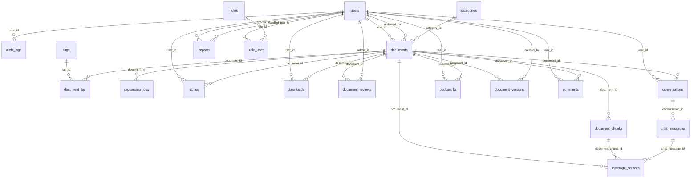

# Mô tả cơ sở dữ liệu `smart_document_hub`

> Tài liệu này được **sinh tự động từ chính database** sau khi import `database/schema_smart_document_hub.sql` (MariaDB 10.11), nên khớp với cấu trúc thực tế.

## Sơ đồ quan hệ (ERD)

## Giải thích quan hệ

**1-n (một-nhiều)** — dạng quan hệ chủ yếu:
- `users` 1-n `documents` (người tải lên), `conversations`, `comments`, `ratings`, `bookmarks`, `downloads`, `reports`.
- `categories` 1-n `documents`.
- `documents` 1-n `document_versions`, `document_reviews`, `document_chunks`, `comments`, `ratings`, `processing_jobs`.
- `conversations` 1-n `chat_messages`; `chat_messages` 1-n `message_sources`; `document_chunks` 1-n `message_sources` (nguồn trích dẫn gắn với chunk thực tế).

**n-n (nhiều-nhiều)** — qua bảng trung gian:
- `users` n-n `roles` qua `role_user`.
- `documents` n-n `tags` qua `document_tag`.
- `users` n-n `documents` qua `bookmarks` (yêu thích), `ratings` (đánh giá, kèm điểm) và `downloads` (lịch sử tải, kèm thời điểm).

**1-1 (logic)**: mỗi cặp (`user`, `document`) chỉ có tối đa 1 bản ghi trong `bookmarks` và `ratings` (ràng buộc UNIQUE). `reports` và `audit_logs` dùng quan hệ đa hình (`*_type` + `*_id`) nên không có khóa ngoại cứng tới đối tượng; `settings` là bảng khóa-giá trị độc lập.

**Chính sách xóa**: dữ liệu lịch sử dùng RESTRICT (`documents.user_id`, `documents.category_id`, `document_reviews.admin_id`, `document_versions.created_by`); dữ liệu phụ thuộc dùng CASCADE (chunk, bình luận, yêu thích…); tham chiếu tùy chọn dùng SET NULL (`documents.reviewed_by`, `audit_logs.user_id`, `message_sources.document_chunk_id`). `documents` dùng xóa mềm (`deleted_at`).

**Không có bảng `document_embeddings`**: dự án chọn kiến trúc RAG dùng truy xuất từ khóa (FULLTEXT) vì MySQL/MariaDB trong XAMPP không có tìm kiếm vector hiệu quả. Xem `docs/KIEN-TRUC.md`.

## Danh sách bảng

### `audit_logs` — Nhật ký kiểm toán

| Cột | Kiểu dữ liệu | Null | Mặc định | Khóa | Ý nghĩa |
|---|---|---|---|---|---|
| `id` | bigint(20) unsigned | không | - | PK | Khóa chính |
| `user_id` | bigint(20) unsigned | có | NULL | FK → users.id | Người thực hiện |
| `action` | varchar(100) | không | - | — | Mã hành động, vd document.approve |
| `subject_type` | varchar(50) | có | NULL | — | Loại đối tượng |
| `subject_id` | bigint(20) unsigned | có | NULL | — | ID đối tượng |
| `metadata` | longtext | có | NULL | — | Chi tiết bổ sung (không chứa dữ liệu nhạy cảm) |
| `ip_address` | varchar(45) | có | NULL | — | IP |
| `created_at` | timestamp | có | NULL | — |  |
| `updated_at` | timestamp | có | NULL | — |  |

### `bookmarks` — Tài liệu yêu thích

| Cột | Kiểu dữ liệu | Null | Mặc định | Khóa | Ý nghĩa |
|---|---|---|---|---|---|
| `id` | bigint(20) unsigned | không | - | PK | Khóa chính |
| `user_id` | bigint(20) unsigned | không | - | FK → users.id | FK -> users.id |
| `document_id` | bigint(20) unsigned | không | - | FK → documents.id | FK -> documents.id |
| `created_at` | timestamp | có | NULL | — |  |
| `updated_at` | timestamp | có | NULL | — |  |

### `categories` — Danh mục tài liệu

| Cột | Kiểu dữ liệu | Null | Mặc định | Khóa | Ý nghĩa |
|---|---|---|---|---|---|
| `id` | bigint(20) unsigned | không | - | PK | Khóa chính |
| `name` | varchar(150) | không | - | UNIQUE | Tên danh mục |
| `slug` | varchar(160) | không | - | UNIQUE | Đường dẫn thân thiện |
| `description` | varchar(500) | có | NULL | — | Mô tả |
| `sort_order` | smallint(5) unsigned | không | 0 | — | Thứ tự hiển thị |
| `is_active` | tinyint(1) | không | 1 | — | 1 = đang dùng |
| `created_at` | timestamp | có | NULL | — |  |
| `updated_at` | timestamp | có | NULL | — |  |

### `chat_messages` — Tin nhắn trong hội thoại

| Cột | Kiểu dữ liệu | Null | Mặc định | Khóa | Ý nghĩa |
|---|---|---|---|---|---|
| `id` | bigint(20) unsigned | không | - | PK | Khóa chính |
| `conversation_id` | bigint(20) unsigned | không | - | FK → conversations.id | FK -> conversations.id |
| `role` | varchar(20) | không | - | — | user | assistant |
| `content` | longtext | không | - | — | Nội dung |
| `mode` | varchar(20) | có | NULL | — | ask | summarize | explain | keypoints | quiz |
| `status` | varchar(20) | không | 'completed' | — | completed | failed |
| `error` | varchar(500) | có | NULL | — | Mã/ghi chú lỗi tích hợp AI |
| `grounded` | tinyint(1) | không | 0 | — | 1 = câu trả lời có dẫn nguồn đã xác minh |
| `created_at` | timestamp | có | NULL | — |  |
| `updated_at` | timestamp | có | NULL | — |  |

### `comments` — Bình luận

| Cột | Kiểu dữ liệu | Null | Mặc định | Khóa | Ý nghĩa |
|---|---|---|---|---|---|
| `id` | bigint(20) unsigned | không | - | PK | Khóa chính |
| `document_id` | bigint(20) unsigned | không | - | FK → documents.id | Tài liệu |
| `user_id` | bigint(20) unsigned | không | - | FK → users.id | Tác giả bình luận |
| `body` | text | không | - | — | Nội dung |
| `status` | varchar(20) | không | 'visible' | — | visible | hidden |
| `created_at` | timestamp | có | NULL | — |  |
| `updated_at` | timestamp | có | NULL | — |  |

### `conversations` — Hội thoại với trợ lý AI

| Cột | Kiểu dữ liệu | Null | Mặc định | Khóa | Ý nghĩa |
|---|---|---|---|---|---|
| `id` | bigint(20) unsigned | không | - | PK | Khóa chính |
| `user_id` | bigint(20) unsigned | không | - | FK → users.id | Chủ hội thoại |
| `title` | varchar(255) | không | - | — | Tiêu đề (rút từ câu hỏi đầu) |
| `scope` | varchar(20) | không | 'all' | — | document | mine | public | all |
| `document_id` | bigint(20) unsigned | có | NULL | FK → documents.id | Tài liệu được chọn khi scope=document |
| `created_at` | timestamp | có | NULL | — |  |
| `updated_at` | timestamp | có | NULL | — |  |

### `documents` — Tài liệu do người dùng tải lên

| Cột | Kiểu dữ liệu | Null | Mặc định | Khóa | Ý nghĩa |
|---|---|---|---|---|---|
| `id` | bigint(20) unsigned | không | - | PK | Khóa chính |
| `user_id` | bigint(20) unsigned | không | - | FK → users.id | Chủ sở hữu (FK -> users.id) |
| `category_id` | bigint(20) unsigned | không | - | FK → categories.id | Danh mục (FK -> categories.id) |
| `title` | varchar(255) | không | - | — | Tiêu đề |
| `description` | text | có | NULL | — | Mô tả |
| `subject` | varchar(150) | có | NULL | — | Môn học / lĩnh vực |
| `original_filename` | varchar(255) | không | - | — | Tên tệp gốc khi tải lên |
| `storage_path` | varchar(500) | không | - | — | Đường dẫn tệp hiện hành trong storage/app (đĩa private) |
| `mime_type` | varchar(100) | không | - | — | MIME type đã xác thực |
| `extension` | varchar(10) | không | - | — | pdf | docx | txt |
| `size_bytes` | bigint(20) unsigned | không | - | — | Dung lượng (byte) |
| `checksum` | char(64) | không | - | — | SHA-256 của tệp, dùng phát hiện trùng |
| `page_count` | smallint(5) unsigned | có | NULL | — | Số trang (PDF) nếu xác định được |
| `visibility` | varchar(20) | không | 'private' | — | public | private |
| `moderation_status` | varchar(20) | không | 'draft' | — | draft | pending | approved | rejected | changes_requested | hidden |
| `processing_status` | varchar(20) | không | 'pending' | — | pending | processing | completed | failed | needs_ocr |
| `processing_error` | text | có | NULL | — | Lỗi xử lý tệp gần nhất |
| `review_note` | varchar(1000) | có | NULL | — | Lý do của quyết định kiểm duyệt gần nhất |
| `reviewed_by` | bigint(20) unsigned | có | NULL | FK → users.id | Admin kiểm duyệt gần nhất |
| `reviewed_at` | timestamp | có | NULL | — | Thời điểm kiểm duyệt gần nhất |
| `submitted_at` | timestamp | có | NULL | — | Thời điểm gửi duyệt |
| `approved_at` | timestamp | có | NULL | — | Thời điểm được duyệt |
| `current_version` | int(10) unsigned | không | 1 | — | Số phiên bản hiện hành |
| `view_count` | int(10) unsigned | không | 0 | — | Lượt xem (mỗi phiên 1 lần, không tính chủ sở hữu) |
| `download_count` | int(10) unsigned | không | 0 | — | Lượt tải (mỗi lượt tải thành công của người dùng đăng nhập) |
| `created_at` | timestamp | có | NULL | — |  |
| `updated_at` | timestamp | có | NULL | — |  |
| `deleted_at` | timestamp | có | NULL | — | Xóa mềm |

### `document_chunks` — Các đoạn văn bản đã trích xuất (phục vụ tìm kiếm và RAG)

| Cột | Kiểu dữ liệu | Null | Mặc định | Khóa | Ý nghĩa |
|---|---|---|---|---|---|
| `id` | bigint(20) unsigned | không | - | PK | Khóa chính |
| `document_id` | bigint(20) unsigned | không | - | FK → documents.id | FK -> documents.id |
| `chunk_index` | int(10) unsigned | không | - | — | Thứ tự đoạn trong tài liệu |
| `page_start` | smallint(5) unsigned | có | NULL | — | Trang bắt đầu (PDF) |
| `page_end` | smallint(5) unsigned | có | NULL | — | Trang kết thúc (PDF) |
| `content` | text | không | - | — | Nội dung đoạn |
| `char_count` | int(10) unsigned | không | - | — | Số ký tự |
| `created_at` | timestamp | có | NULL | — |  |
| `updated_at` | timestamp | có | NULL | — |  |

### `document_reviews` — Lịch sử từng lần kiểm duyệt

| Cột | Kiểu dữ liệu | Null | Mặc định | Khóa | Ý nghĩa |
|---|---|---|---|---|---|
| `id` | bigint(20) unsigned | không | - | PK | Khóa chính |
| `document_id` | bigint(20) unsigned | không | - | FK → documents.id | FK -> documents.id |
| `admin_id` | bigint(20) unsigned | không | - | FK → users.id | Admin ra quyết định |
| `decision` | varchar(30) | không | - | — | approve | reject | changes | hide | restore |
| `reason` | varchar(1000) | có | NULL | — | Lý do |
| `version_number` | int(10) unsigned | không | - | — | Phiên bản tài liệu được duyệt |
| `created_at` | timestamp | có | NULL | — |  |
| `updated_at` | timestamp | có | NULL | — |  |

### `document_tag` — Bảng trung gian n-n giữa tài liệu và thẻ

| Cột | Kiểu dữ liệu | Null | Mặc định | Khóa | Ý nghĩa |
|---|---|---|---|---|---|
| `document_id` | bigint(20) unsigned | không | - | PK, FK → documents.id | FK -> documents.id |
| `tag_id` | bigint(20) unsigned | không | - | PK, FK → tags.id | FK -> tags.id |

### `document_versions` — Các phiên bản tệp của tài liệu

| Cột | Kiểu dữ liệu | Null | Mặc định | Khóa | Ý nghĩa |
|---|---|---|---|---|---|
| `id` | bigint(20) unsigned | không | - | PK | Khóa chính |
| `document_id` | bigint(20) unsigned | không | - | FK → documents.id | FK -> documents.id |
| `version_number` | int(10) unsigned | không | - | — | Số phiên bản (bắt đầu từ 1) |
| `original_filename` | varchar(255) | không | - | — | Tên tệp gốc |
| `storage_path` | varchar(500) | không | - | — | Đường dẫn tệp của phiên bản |
| `size_bytes` | bigint(20) unsigned | không | - | — | Dung lượng (byte) |
| `checksum` | char(64) | không | - | — | SHA-256 |
| `created_by` | bigint(20) unsigned | không | - | FK → users.id | Người tải phiên bản |
| `created_at` | timestamp | có | NULL | — |  |
| `updated_at` | timestamp | có | NULL | — |  |

### `downloads` — Lịch sử tải xuống

| Cột | Kiểu dữ liệu | Null | Mặc định | Khóa | Ý nghĩa |
|---|---|---|---|---|---|
| `id` | bigint(20) unsigned | không | - | PK | Khóa chính |
| `user_id` | bigint(20) unsigned | không | - | FK → users.id | Người tải |
| `document_id` | bigint(20) unsigned | không | - | FK → documents.id | Tài liệu |
| `version_number` | int(10) unsigned | không | 1 | — | Phiên bản đã tải |
| `ip_address` | varchar(45) | có | NULL | — | IP |
| `created_at` | timestamp | có | NULL | — |  |
| `updated_at` | timestamp | có | NULL | — |  |

### `failed_jobs` — Job thất bại (Laravel queue)

| Cột | Kiểu dữ liệu | Null | Mặc định | Khóa | Ý nghĩa |
|---|---|---|---|---|---|
| `id` | bigint(20) unsigned | không | - | PK |  |
| `uuid` | varchar(255) | không | - | UNIQUE |  |
| `connection` | text | không | - | — |  |
| `queue` | text | không | - | — |  |
| `payload` | longtext | không | - | — |  |
| `exception` | longtext | không | - | — |  |
| `failed_at` | timestamp | không | current_timestamp() | — |  |

### `jobs` — Hàng đợi database (Laravel queue)

| Cột | Kiểu dữ liệu | Null | Mặc định | Khóa | Ý nghĩa |
|---|---|---|---|---|---|
| `id` | bigint(20) unsigned | không | - | PK |  |
| `queue` | varchar(255) | không | - | — |  |
| `payload` | longtext | không | - | — |  |
| `attempts` | tinyint(3) unsigned | không | - | — |  |
| `reserved_at` | int(10) unsigned | có | NULL | — |  |
| `available_at` | int(10) unsigned | không | - | — |  |
| `created_at` | int(10) unsigned | không | - | — |  |

### `message_sources` — Nguồn trích dẫn của câu trả lời AI (gắn với chunk thực tế)

| Cột | Kiểu dữ liệu | Null | Mặc định | Khóa | Ý nghĩa |
|---|---|---|---|---|---|
| `id` | bigint(20) unsigned | không | - | PK | Khóa chính |
| `chat_message_id` | bigint(20) unsigned | không | - | FK → chat_messages.id | FK -> chat_messages.id |
| `document_id` | bigint(20) unsigned | không | - | FK → documents.id | FK -> documents.id |
| `document_chunk_id` | bigint(20) unsigned | có | NULL | FK → document_chunks.id | Chunk được trích (NULL nếu đã xử lý lại) |
| `ref_no` | tinyint(3) unsigned | không | - | — | Số [n] hiển thị trong câu trả lời |
| `page_start` | smallint(5) unsigned | có | NULL | — | Trang của đoạn trích |
| `excerpt` | text | không | - | — | Đoạn trích nguyên văn từ chunk |
| `score` | double | có | NULL | — | Điểm truy xuất |
| `created_at` | timestamp | có | NULL | — |  |
| `updated_at` | timestamp | có | NULL | — |  |

### `notifications` — Thông báo cho người dùng

| Cột | Kiểu dữ liệu | Null | Mặc định | Khóa | Ý nghĩa |
|---|---|---|---|---|---|
| `id` | char(36) | không | - | PK |  |
| `type` | varchar(255) | không | - | — | Lớp thông báo |
| `notifiable_type` | varchar(255) | không | - | — |  |
| `notifiable_id` | bigint(20) unsigned | không | - | — | ID người nhận |
| `data` | text | không | - | — | Nội dung JSON |
| `read_at` | timestamp | có | NULL | — | Thời điểm đã đọc |
| `created_at` | timestamp | có | NULL | — |  |
| `updated_at` | timestamp | có | NULL | — |  |

### `password_resets` — Token đặt lại mật khẩu (Laravel)

| Cột | Kiểu dữ liệu | Null | Mặc định | Khóa | Ý nghĩa |
|---|---|---|---|---|---|
| `email` | varchar(255) | không | - | PK | Email yêu cầu đặt lại |
| `token` | varchar(255) | không | - | — | Token đã băm |
| `created_at` | timestamp | có | NULL | — |  |

### `processing_jobs` — Nhật ký tác vụ nền xử lý tệp

| Cột | Kiểu dữ liệu | Null | Mặc định | Khóa | Ý nghĩa |
|---|---|---|---|---|---|
| `id` | bigint(20) unsigned | không | - | PK | Khóa chính |
| `document_id` | bigint(20) unsigned | không | - | FK → documents.id | Tài liệu được xử lý |
| `type` | varchar(30) | không | 'extract_text' | — | Loại tác vụ |
| `status` | varchar(20) | không | 'queued' | — | queued | running | completed | failed | needs_ocr |
| `attempts` | tinyint(3) unsigned | không | 0 | — | Số lần thử |
| `error` | text | có | NULL | — | Thông báo lỗi |
| `started_at` | timestamp | có | NULL | — | Bắt đầu |
| `finished_at` | timestamp | có | NULL | — | Kết thúc |
| `created_at` | timestamp | có | NULL | — |  |
| `updated_at` | timestamp | có | NULL | — |  |

### `ratings` — Đánh giá tài liệu (1-5 sao)

| Cột | Kiểu dữ liệu | Null | Mặc định | Khóa | Ý nghĩa |
|---|---|---|---|---|---|
| `id` | bigint(20) unsigned | không | - | PK | Khóa chính |
| `user_id` | bigint(20) unsigned | không | - | FK → users.id | Người đánh giá |
| `document_id` | bigint(20) unsigned | không | - | FK → documents.id | Tài liệu |
| `score` | tinyint(3) unsigned | không | - | — | Điểm 1..5 |
| `created_at` | timestamp | có | NULL | — |  |
| `updated_at` | timestamp | có | NULL | — |  |

### `reports` — Báo cáo nội dung vi phạm (đa hình: document | comment)

| Cột | Kiểu dữ liệu | Null | Mặc định | Khóa | Ý nghĩa |
|---|---|---|---|---|---|
| `id` | bigint(20) unsigned | không | - | PK | Khóa chính |
| `reporter_id` | bigint(20) unsigned | không | - | FK → users.id | Người báo cáo |
| `reportable_type` | varchar(50) | không | - | — | document | comment |
| `reportable_id` | bigint(20) unsigned | không | - | — | ID đối tượng bị báo cáo |
| `reason` | varchar(100) | không | - | — | Lý do chọn sẵn |
| `details` | text | có | NULL | — | Chi tiết bổ sung |
| `status` | varchar(20) | không | 'open' | — | open | resolved | dismissed |
| `handled_by` | bigint(20) unsigned | có | NULL | FK → users.id | Admin xử lý |
| `handled_at` | timestamp | có | NULL | — | Thời điểm xử lý |
| `resolution_note` | varchar(1000) | có | NULL | — | Ghi chú xử lý |
| `created_at` | timestamp | có | NULL | — |  |
| `updated_at` | timestamp | có | NULL | — |  |

### `roles` — Vai trò hệ thống (admin, user)

| Cột | Kiểu dữ liệu | Null | Mặc định | Khóa | Ý nghĩa |
|---|---|---|---|---|---|
| `id` | bigint(20) unsigned | không | - | PK | Khóa chính |
| `name` | varchar(50) | không | - | UNIQUE | Mã vai trò: admin | user |
| `label` | varchar(100) | không | - | — | Tên hiển thị |
| `created_at` | timestamp | có | NULL | — |  |
| `updated_at` | timestamp | có | NULL | — |  |

### `role_user` — Bảng trung gian n-n giữa người dùng và vai trò

| Cột | Kiểu dữ liệu | Null | Mặc định | Khóa | Ý nghĩa |
|---|---|---|---|---|---|
| `role_id` | bigint(20) unsigned | không | - | PK, FK → roles.id | FK -> roles.id |
| `user_id` | bigint(20) unsigned | không | - | PK, FK → users.id | FK -> users.id |

### `settings` — Cấu hình ứng dụng chỉnh được trong trang admin

| Cột | Kiểu dữ liệu | Null | Mặc định | Khóa | Ý nghĩa |
|---|---|---|---|---|---|
| `setting_key` | varchar(100) | không | - | PK | Khóa cấu hình |
| `setting_value` | text | có | NULL | — | Giá trị |
| `created_at` | timestamp | có | NULL | — |  |
| `updated_at` | timestamp | có | NULL | — |  |

### `tags` — Thẻ (từ khóa) gắn cho tài liệu

| Cột | Kiểu dữ liệu | Null | Mặc định | Khóa | Ý nghĩa |
|---|---|---|---|---|---|
| `id` | bigint(20) unsigned | không | - | PK | Khóa chính |
| `name` | varchar(60) | không | - | UNIQUE | Tên thẻ |
| `slug` | varchar(70) | không | - | UNIQUE | Đường dẫn thân thiện |
| `created_at` | timestamp | có | NULL | — |  |
| `updated_at` | timestamp | có | NULL | — |  |

### `users` — Tài khoản người dùng

| Cột | Kiểu dữ liệu | Null | Mặc định | Khóa | Ý nghĩa |
|---|---|---|---|---|---|
| `id` | bigint(20) unsigned | không | - | PK | Khóa chính |
| `name` | varchar(255) | không | - | — | Họ tên |
| `email` | varchar(255) | không | - | UNIQUE | Email đăng nhập (duy nhất) |
| `email_verified_at` | timestamp | có | NULL | — | Thời điểm xác thực email |
| `password` | varchar(255) | không | - | — | Mật khẩu đã băm (bcrypt) |
| `remember_token` | varchar(100) | có | NULL | — | Token ghi nhớ đăng nhập |
| `is_active` | tinyint(1) | không | 1 | — | 1 = hoạt động, 0 = bị khóa |
| `locked_reason` | varchar(255) | có | NULL | — | Lý do khóa tài khoản |
| `bio` | text | có | NULL | — | Giới thiệu ngắn |
| `ai_consent_at` | timestamp | có | NULL | — | Thời điểm đồng ý cho AI xử lý tài liệu riêng tư của chính mình |
| `last_login_at` | timestamp | có | NULL | — | Lần đăng nhập gần nhất |
| `created_at` | timestamp | có | NULL | — |  |
| `updated_at` | timestamp | có | NULL | — |  |
